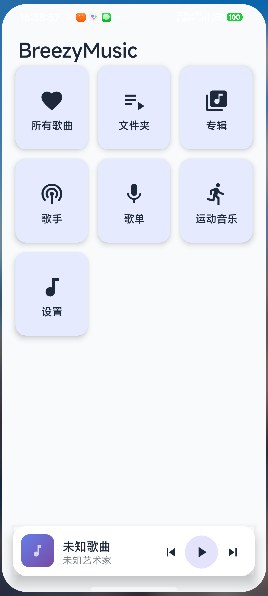
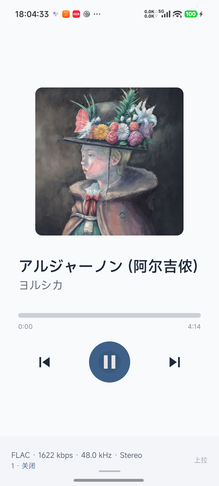
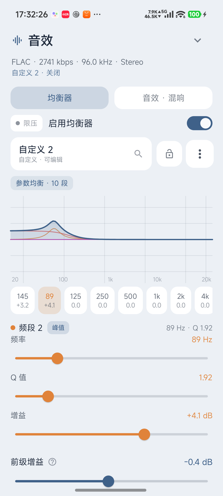
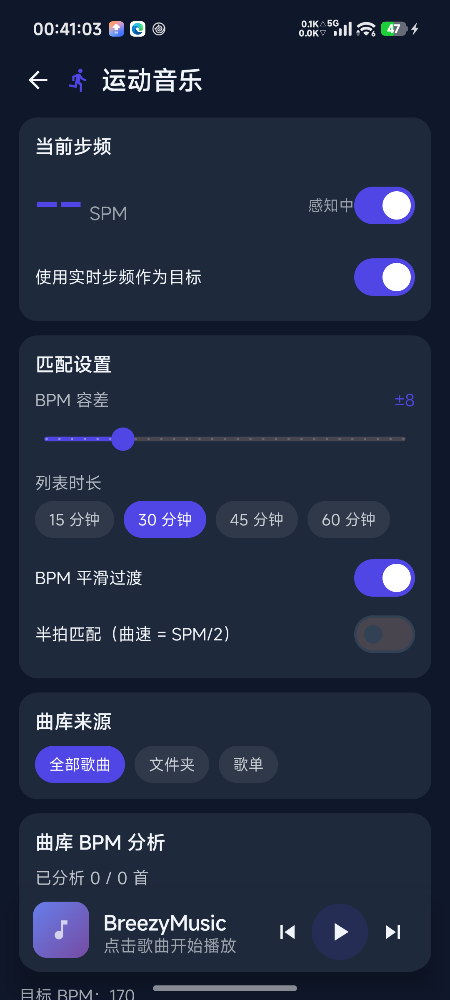
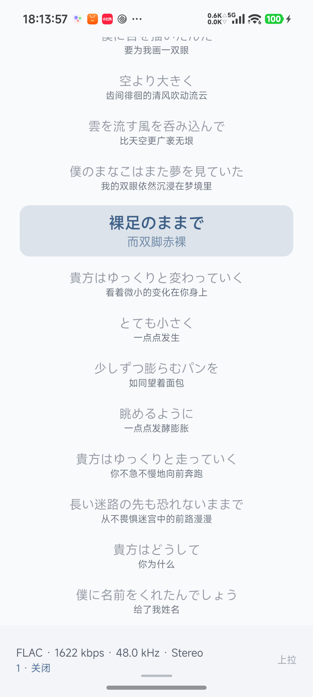

# BreezyMusic

**一个自己写 UI 框架、自己写音频链路的本地音乐播放器。**

Android · Kotlin · Jetpack Compose · ExoPlayer · 自研 BreezyUI

[](https://github.com/BlueEve04/BreezyMusic/releases)
[](#)
[](#)
[](#)
[](LICENSE)

BreezyMusic 是一个完全离线的本地音乐播放器：不联网、不上传、不申请多余权限，扫你的文件夹，放你的歌。
界面不是用 Material 现成组件拼的——按钮、卡片、对话框、列表、导航、动效全部来自同仓库的 UI 框架 **BreezyUI**，所以它能有一致的手感，也能为了让"播放页从 Dock 长成整页"这一件事去改框架本身。

---

## 截图

| 主页 | 播放页 | 均衡器 |
| :---: | :---: | :---: |
|  |  |  |

| 运动音乐 | 歌词 |
| :---: | :---: |
|  |  |

> 截图取自开发版，真机（Xiaomi 15 Ultra / Android 17）直接截屏。

---

## 功能

### 播放

- 扫描本地文件夹（SAF 授权），递归识别 `mp3 / flac / wav / ogg / m4a / aac / wma`，元数据写入 Room
- 后台播放、通知栏与锁屏控制、可拖动的媒体进度条（`ACTION_SEEK_TO` + `onSeekTo`）
- 顺序 / 单曲 / 随机播放，播放列表可拖拽排序，退出后恢复上次队列
- 播放页是一条**从底部 Dock 长成整页**的连续动画：封面、标题、进度、按钮在同一个坐标系里插值，而不是"弹出新页面"

### 音效

- **图示均衡**：3–20 段，可横向滚动，点数值可直接输入 dB
- **参数均衡**：每段独立设类型（峰值 / 低架 / 高架）、频率、Q 与增益；每段固定配色，单独响应曲线叠加在同一坐标系
- **预设**：内置 14 组，可锁定、可一键还原；自定义预设可新建、改名、删除
- **混响**：8 组预设（房间 / 大厅 / 教堂 / 板式 / 现场…），湿度与房间大小可调
- **限压器**：阈值 −12…0 dBFS 可调，触发时按钮按强度闪烁；瞬时攻击（一阶平滑会让峰值漏过去）
- **按输出设备分档**：外放 / 听筒 / 有线 / 蓝牙 / USB 各自一套参数
- 信号链：`解码 → 前级增益 → N 段双二阶 → 混响 → 限压 → AudioTrack`，全在一个自写的 `AudioProcessor` 里

### 运动音乐

- 全库 BPM 分析：解码前 60 秒 → 下混单声道 → 重采样 22.05 kHz → 512 帧能量包络 → onset 半波整流 → 60–200 BPM 自相关 + 70–180 节奏先验 → 抛物线插值细化
- 读取实时步频（`TYPE_STEP_COUNTER`，无传感器时退化为加速度计峰值检测）
- 按 `|BPM − 目标|` 与相邻曲目 BPM 跳变做贪心排序，生成定长（15/30/45/60 分钟）歌单
- 分析结果写进 Room，可断点续跑；并发度按 CPU 核数自适应

### 歌词

- LRC 解析，支持多轨（原文 / 翻译 / 次级）
- 逐行高亮、居中滚动；手动滑动后暂停自动回正，延迟可在设置里改（3/5/8/10 秒），期间仍然跟随高亮但不抢滚动
- 通过 **Super Lyric** 的 Binder 接口把整首歌词外发给状态栏歌词应用（API v4，旧版接收端自动回退 legacy 通道）

### 歌单与排序

- m3u8 解析：BOM 探测（UTF-8 / UTF-16）→ 严格 UTF-8 解码失败回退 GB18030；`#EXTINF` 标题与时长；相对路径以歌单所在目录为基准；反斜杠与 `%20` 归一化
- 六级级联匹配：归一化全路径 → 路径后缀 → 文件名主干（重名时用父目录缩小）→ `#EXTINF` 标题 → 标题包含 → 文件名包含；保持原顺序去重，未命中项单独统计
- 排序：自然序（`Track 2` < `Track 10`）、多字段、升降序、稳定 tie-break、拼音首字母分桶

### 界面

- 自研 UI 框架 BreezyUI：主题色板、圆角、排版、按压缩放、对话框、导航、分页器
- 播放页 / 歌词页 / 播放列表页**共用一张**封面模糊混色背景；左右滑动时只有元素缩放与模糊，背景不动
- 模糊不用 `Modifier.blur`（RenderEffect 每帧重算，还有"什么时候开始模糊"的露馅时机），改成在原始像素上做三次可分离盒式模糊，按路径缓存
- 播放按钮与进度条颜色取自封面（平均色经 HSV 提升），不跟全局主题色

---

## 设计要点

### 为什么先有 UI 框架

播放器这类应用，页面结构其实是重复的：卡片列表、详情页、底部 Dock、选择弹窗。如果每次都直接写 Compose，同一套圆角阴影和按压反馈会散落在几十个文件里，改一次全局观感要改几十处。
所以 BreezyUI 先行：先把按钮 / 卡片 / 对话框 / 列表 / 导航 / 主题做成有明确 API 的组件，业务页面只做组合。代价是框架本身要维护（比如"按压时三个独立动画导致列表卡顿"这类问题必须在框架层修），收益是后面每个新页面都很快。

### 播放内核的替换

第一版用 `MediaPlayer`，要加均衡器时发现没有插入点。换成 ExoPlayer 后，通过 `DefaultRenderersFactory.buildAudioSink` 把自写的 `BaseAudioProcessor` 注入 `DefaultAudioSink`：

```kotlin
override fun buildAudioSink(
    context: Context, enableFloatOutput: Boolean, enableAudioTrackPlaybackParams: Boolean
): AudioSink = DefaultAudioSink.Builder(context)
    .setAudioProcessors(arrayOf(dsp))
    .build()
```

对外接口（`play / pause / resume / stop / seekTo / isStopped`）一个字没改，上层页面零改动——这是"再生工程"里典型的一步：换实现，不换契约。

### 几个踩过的坑

| 现象 | 根因 | 修法 |
| --- | --- | --- |
| 高清曲目播放成白噪音 | 解码器对 24bit FLAC 输出 **float PCM**，处理器按 16bit 解析 | 按 `inputAudioFormat.encoding` 分支读写 |
| Dock 上拉时有两个矩形、边缘毛糙 | 卡片 `shadowElevation` 按图层矩形投影，圆角下面压着直角影子 | 删掉 elevation，背景层再 clip 一次圆角 |
| 上拉时"闪现一下没模糊的背景" | `Modifier.blur` 由进度阈值开关，动画中途才打开 | 不用 RenderEffect，位图取到时就模糊好 |
| 全展开还能看见主界面 | 卡片底色淡出 + 背景淡入，中间同时半透明 | 底色恒不透明，只让背景层淡入 |
| 音效面板拖到一半卡住 | 归位动画的 `LaunchedEffect` 依赖进度值，动画自己改进度又取消自己 | 归位改用独立 `Job`，只由一次手势触发 |

---

## 快速开始

### 环境

- JDK 17+（开发用 21）
- Android SDK：`compileSdk 35`、`build-tools 34.0.0`
- Android Studio Ladybug 及以上，或命令行 Gradle 8.5

### 依赖 BreezyUI

UI 框架以**同级目录**引入，克隆时把两个仓库放在同一个父目录：

```text
your-workspace/
├── BreezyMusic/
└── BreezyUI/
```

```bash
git clone https://github.com/BlueEve04/BreezyMusic.git
git clone https://github.com/BlueEve04/BreezyUI.git
```

`settings.gradle.kts` 里已经写好了映射：

```kotlin
include(":breezy-ui")
project(":breezy-ui").projectDir = File("../BreezyUI/breezy-ui")
```

### 构建

```bash
# 指向本机 SDK（也可以用 ANDROID_HOME）
echo "sdk.dir=/path/to/Android/Sdk" > local.properties

./gradlew :app:assembleDebug
./gradlew :app:testDebugUnitTest
```

release 需要自备签名，在仓库根目录放 `keystore.properties`（已被 `.gitignore` 忽略）：

```properties
storeFile=/path/to/your.jks
storePassword=******
keyAlias=******
keyPassword=******
```

```bash
./gradlew :app:assembleRelease
```

### 安装

从 [Releases](https://github.com/BlueEve04/BreezyMusic/releases) 下载 APK，或

```bash
adb install -r app/build/outputs/apk/release/app-release.apk
```

首次启动按引导授予「通知」与「读取音频」权限，然后在 设置 → 音乐文件夹管理 里添加一个目录。

---

## 工程结构

```text
app/src/main/java/com/breezy/music/
├── model/
│   ├── AudioEngine.kt            ExoPlayer 封装 + DSP 注入
│   ├── PlaybackState.kt          全局播放状态（Compose 可观察）
│   ├── MusicDatabase.kt          Room：songs / folders
│   ├── MusicLibrary.kt           SAF 扫描与入库
│   ├── BpmAnalyzer.kt            单曲 BPM 检测
│   ├── BpmRepository.kt          并发分析调度与缓存
│   ├── CadenceTracker.kt         步频传感器
│   ├── RunningMusicGenerator.kt  运动歌单生成
│   ├── LyricParser.kt            LRC 解析与多轨合并
│   └── LyricPublisher.kt         Super Lyric 外发
├── audio/
│   ├── BreezyDspProcessor.kt     前级 → 均衡 → 混响 → 限压
│   ├── EqCurve.kt                响应曲线计算（纯函数，可单测）
│   ├── EqPresets.kt              内置预设
│   └── AudioEffects.kt           音效状态机与持久化
├── ui/
│   ├── HomeScreen.kt             主页与卡片展开
│   ├── MusicPlayerScreen.kt      Dock ↔ 全屏播放页
│   ├── AudioEffectsPanel.kt      音效面板（均衡器 / 音效·混响）
│   ├── LyricsPage.kt             歌词页
│   ├── RunningMusicPage.kt       运动音乐
│   ├── CoverBackdrop.kt          封面取色与模糊背景
│   └── SettingsScreen.kt         设置
└── util/
    ├── M3u8Parser.kt             歌单解析与六级匹配
    └── SongSortUtil.kt           自然序 / 多字段排序
```

测试在 `app/src/test/`，全部是纯 JVM 逻辑（排序、歌单解析、运动歌单、EQ 曲线、歌词外发），`./gradlew :app:testDebugUnitTest` 直接跑，不需要真机。

---

## 已知限制

- **只支持本地文件**：没有网络播放，也没有在线歌词匹配
- **BPM 分析只取前 60 秒**：intro 很长的曲子可能判错
- **Super Lyric 外发依赖接收端**：设备上没装状态栏歌词应用时功能静默不生效
- **构建层有一笔技术债**：Super Lyric 4.0 的库用 Kotlin 2.2 元数据编译，本项目仍是 Kotlin 1.9，靠 `-Xskip-metadata-version-check` 顶着；升级编译器后应当移除
- minSdk 24，但状态栏歌词需要 Android 8.0+（运行时判断，低版本自动隐藏入口）

---

## 致谢

- [ExoPlayer / Media3](https://github.com/androidx/media) — 播放与音频处理管线
- [Super Lyric](https://github.com/HChenX/SuperLyricApi) — 状态栏歌词协议
- [RBJ Audio EQ Cookbook](https://www.w3.org/TR/audio-eq-cookbook/) — 双二阶滤波器系数
- [Jetpack Compose](https://developer.android.com/jetpack/compose) — 声明式 UI 基础

---

## License

[MIT](LICENSE) © BlueEve
